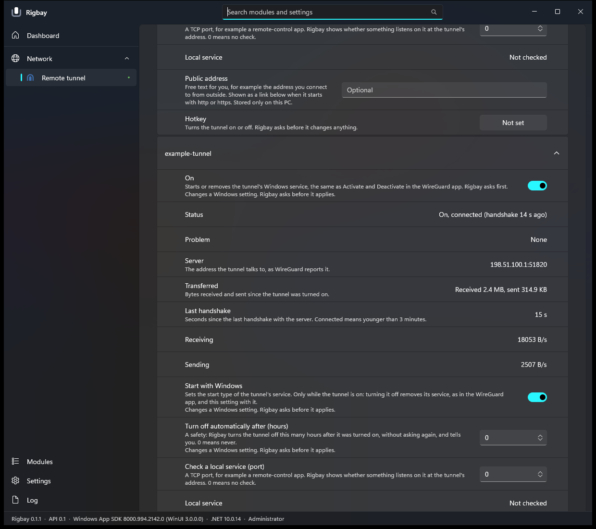

# Remote tunnel module for Rigbay

Turns the WireGuard tunnels installed on this PC on and off from [Rigbay](https://github.com/rigbay-app/rigbay), from its page, the tray, a hotkey or the
command line, and shows how each tunnel is doing (running, newest handshake, server, bytes received and sent). Think of the switch of a VPN app, for your own WireGuard server.

Version 0.1.0, pre-release. MIT.

- **Needs the official WireGuard for Windows** (<https://www.wireguard.com/install/>). Nothing of WireGuard is bundled. The module checks that `wireguard.exe` and `wg.exe` are signed by WireGuard LLC before it runs them; otherwise it is "unsupported" and says where to get WireGuard.
- **It does what the WireGuard app does**: On = `wireguard.exe /installtunnelservice` with the file in WireGuard's own store, Off = `wireguard.exe /uninstalltunnelservice <name>`. A tunnel turned on in either place shows as on in both.
- **It never reads a configuration** (they hold private keys): it lists the names of the files in `%ProgramFiles%\WireGuard\Data\Configurations` (`*.conf.dpapi` and `*.conf`) and passes the path of the existing file to WireGuard. Status comes from three calls, `wg show <name> latest-handshakes|transfer|endpoints`; `wg show` without a field, `dump` and `showconf` cannot be called from the code.
- **Every change asks first**, from the page, the tray, a hotkey or `rigbay tunnel on|off`: "Turn on tunnel NAME" / "Turn off tunnel NAME". When Rigbay cannot ask (no window), nothing changes. The approval service cannot remember an answer, so it always asks.
- Per tunnel: turn off automatically after N hours (default never; the host asks when you set it), start with Windows (the service's start type; the page explains it goes away when the tunnel is turned off), check a local service (a TCP port on the tunnel's address), a public address you type (stored only on your PC), a hotkey.
- Metrics on the bus (so charts and the recorder pick them up): `tunnel.<name>.rx_rate`, `tunnel.<name>.tx_rate` (bytes per second), `tunnel.<name>.handshake_age` (seconds). Connected means a handshake younger than 3 minutes.
- English and Vietnamese. After a turn-on it waits up to 30 s for the server and says "the server is not answering, check the internet or the server" if there is no handshake.

```
rigbay tunnel list
rigbay tunnel status [name]
rigbay tunnel on <name>       # asks, then waits up to 30 s for the server to answer
rigbay tunnel off <name>      # asks
```



(The pictures come from the demo build in `tools/demo`, which is the real module on a made-up machine with example tunnels; they show no real network.)

## What the module declares

Before any of its code runs, Rigbay shows the manifest: administrator rights; the service `WireGuardTunnel$<name>` (installed, removed, start type); reads the folder `%ProgramFiles%\WireGuard`; the tunnel adapter's addresses and the local TCP listeners (only for the optional local-service check). It touches no registry value itself and sends nothing on the network itself.

## Build

Needs Windows and the .NET SDK (the module targets `net8.0`; the host's language checker is `net10.0`). The host contract (`Rigbay.Abstractions`) comes from the submodule `external/rigbay`:

```powershell
git clone --recurse-submodules https://github.com/rigbay-app/module-tunnel.git
cd module-tunnel
dotnet build Rigbay.Tunnel.slnx -c Release     # 0 warnings expected
dotnet test  Rigbay.Tunnel.slnx -c Release     # 117 tests with fakes: no process, no service, no network, no sleeping
dotnet run --project external/rigbay/src/Rigbay.LangCheck -c Release -- src/Rigbay.Tunnel/lang --module tunnel --source src/Rigbay.Tunnel --strict
```

## Install

From Rigbay's Modules page once it is in the registry. By hand: copy `src/Rigbay.Tunnel/bin/Release/net8.0/` (`module.json`, `icon*.svg`, `lang/`, `Rigbay.Tunnel.dll`, without `Rigbay.Abstractions.*`) to `%ProgramData%\Rigbay\modules\tunnel\`, start Rigbay as administrator, and accept what the module declares.

`tools/demo` is a build of the real module on a made-up machine (two example tunnels), for looking at the page without WireGuard: `powershell -ExecutionPolicy Bypass -File tools\demo\build-demo.ps1 -OutDir <folder>` and point Rigbay's `--modules` at that folder. It changes nothing.

## Safety

The module changes one thing on the machine: the Windows service of a WireGuard tunnel (it exists and runs = on), through the two commands of the official program, plus the service's start type when you ask. Every change is asked about, one runs at a time, and the tunnel name is checked (1 to 32 of `A-Za-z0-9_=+.-`) before it reaches a command line. The automatic turn-off only ever turns a tunnel off. Stopping Rigbay does not change a tunnel. Tests scan the source: no file is opened (so no configuration can be read), no key-printing `wg` call, no registry, no service start or stop other than the official commands.

## Verified, and not

Verified on one machine (Windows 11, WireGuard for Windows as installed there, one tunnel with one peer): the 117 tests; the page drawn in the real Rigbay app (dark, light, Vietnamese; pictures in `docs/evidence`); and a live check with the real tunnel through `rigbay tunnel off|on|status` (approval answered by Rigbay's test switch): the service disappeared and came back in 0.3 s, a handshake followed within seconds, the status read the real `wg show` output, and the start type was Automatic again afterwards. The store file of that tunnel was a plain `.conf`.

**Not verified:** the page switch, the tray item and the hotkey on a real tunnel; the real approval dialog clicked by a person; a notification banner on screen; a failing start, the 30-second no-handshake path, the automatic turn-off and "Start with Windows" on a real tunnel (fakes only); several peers, IPv6, other WireGuard or Windows versions, a store outside the default folder. The full record is in [docs/MODULE.md](docs/MODULE.md).

## Docs

[docs/MODULE.md](docs/MODULE.md): design, the WireGuard facts that were checked and where, problems in plain words, verification record. Notes for changing the module live in the Rigbay repository (`.claude/skills/tunnel-module/`).
